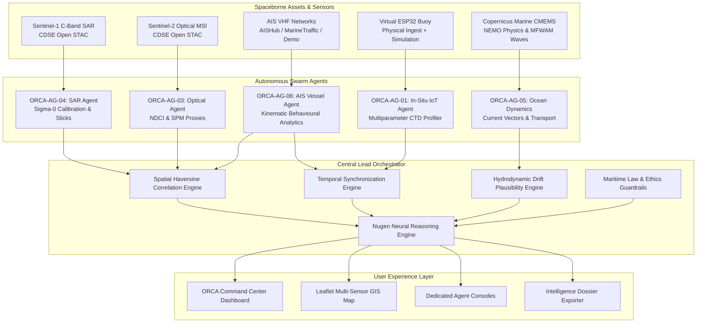

# ORCA – Marine Ecosystem Reasoning with Collaborative Autonomous Agents

[](https://hackathon.example.com)
[](https://hackathon.example.com)
[](https://fastapi.tiangolo.com)
[](https://react.dev)
[-success.svg)](backend/tests)
[-brightgreen.svg)](frontend)

---

## 🌊 Executive Summary

**ORCA** is an autonomous multi-agent marine intelligence and ecosystem reasoning platform developed for the **Indradhanu Hackathon 2026: AI for Greener Tomorrow**. 

Maritime monitoring is traditionally fragmented across isolated portals: radar satellites for oil slicks, optical satellites for algal blooms, numerical models for ocean currents, transponder networks for shipping, and coastal buoys for water chemistry. When ecological disasters occur, authorities are hindered by siloed data, conflicting reports, and lack of cross-sensor corroboration.

ORCA solves this by uniting **five specialized autonomous agents** under a central **Nugen-aligned Lead Orchestrator**:
1. **Sentinel-1 SAR Agent (`ORCA-AG-04`)**: C-Band synthetic aperture radar for dark slick and oil spill candidate extraction with speckle filtering and decibel calibration.
2. **Sentinel-2 Optical Agent (`ORCA-AG-03`)**: Level-2A multispectral remote sensing for aquatic pixel extraction, cloud screening, NDCI chlorophyll proxies, and SPM turbidity indicators.
3. **Copernicus Marine Agent (`ORCA-AG-05`)**: Numerical ocean physics (NEMO) and wave spectra (MFWAM) modeling for surface currents, drift vectors, and temperature transport.
4. **AIS Vessel Intelligence Agent (`ORCA-AG-06`)**: VHF transponder tracking and behavioral kinematics (loitering, dark activity, evasive course changes, MPA intrusions) guarded by Rule 8 maritime law ethics.
5. **Virtual ESP32 Buoy & IoT Agent (`ORCA-AG-01`)**: Multiparameter CTD telemetry (DO, pH, NTU, PSU, °C) with live scenario switching and secure authenticated hardware ingestion.

---

## 🏛️ System Architecture



---

## ⚡ Quickstart Guide (Localhost Execution)

### Terminal 1: Backend API (FastAPI)
```powershell
cd backend
python -m venv venv
.\venv\Scripts\Activate.ps1
pip install -r requirements.txt
python -m uvicorn app.main:app --host 127.0.0.1 --port 8000 --reload
```
- **Backend API**: [http://127.0.0.1:8000](http://127.0.0.1:8000)
- **Interactive OpenAPI Docs**: [http://127.0.0.1:8000/docs](http://127.0.0.1:8000/docs)
- **Health Check**: [http://127.0.0.1:8000/api/v1/health](http://127.0.0.1:8000/api/v1/health)

### Terminal 2: Frontend Dashboard (React + Vite)
```powershell
cd frontend
npm install
npm run dev -- --host 127.0.0.1
```
- **Command Center UI**: [http://127.0.0.1:5173](http://127.0.0.1:5173)

---

## 📚 Comprehensive Documentation Suite

| Document | Purpose |
| :--- | :--- |
| [**LOCAL_SETUP.md**](file:///c:/Users/ATHARV/OneDrive/Desktop/ORCA%20FINAL%20PROTOTYPE/LOCAL_SETUP.md) | Complete step-by-step local installation, dependencies, and troubleshooting |
| [**HACKATHON_DEMO_GUIDE.md**](file:///c:/Users/ATHARV/OneDrive/Desktop/ORCA%20FINAL%20PROTOTYPE/HACKATHON_DEMO_GUIDE.md) | 7-part live demonstration script tailored for hackathon judges |
| [**SYSTEM_ARCHITECTURE.md**](file:///c:/Users/ATHARV/OneDrive/Desktop/ORCA%20FINAL%20PROTOTYPE/SYSTEM_ARCHITECTURE.md) | Detailed technical architecture, math models, and multi-agent coordination |
| [**API_DOCUMENTATION.md**](file:///c:/Users/ATHARV/OneDrive/Desktop/ORCA%20FINAL%20PROTOTYPE/API_DOCUMENTATION.md) | Full REST endpoint reference, query parameters, and JSON payloads |
| [**DATA_PROVENANCE_AND_LIMITATIONS.md**](file:///c:/Users/ATHARV/OneDrive/Desktop/ORCA%20FINAL%20PROTOTYPE/DATA_PROVENANCE_AND_LIMITATIONS.md) | Scientific integrity disclosures, sensor limitations, and simulation isolation |

---

## 🧪 Automated Testing & Verification

ORCA is validated by an exhaustive **131-test automated suite** covering all phases:

```powershell
pytest -v
```

```text
======================= 131 passed, 2 warnings in 83.55s =======================
- tests/test_sar_phase1.py:           11 passed (100%)
- tests/test_oceanographic_phase2.py: 19 passed (100%)
- tests/test_optical_phase3.py:       19 passed (100%)
- tests/test_ais.py:                  26 passed (100%)
- tests/test_iot.py:                  15 passed (100%)
- tests/test_orchestration.py:        22 passed (100%)
- tests/test_nugen.py:                11 passed (100%)
- tests/test_data_integrity.py:        8 passed (100%)
```

Frontend production build verification:
```powershell
npm run build
```
```text
✓ built in 2.35s with 0 errors
```

---

## ⚖️ Scientific Integrity & Legal Guardrails

- **Zero Silent Substitution**: When an external feed is unavailable, ORCA reports `NOT CONNECTED` or `FAILED` instead of secretly fabricating synthetic mock data.
- **Rule 8 Maritime Law Guardrail**: AIS vessel proximity to a detected marine anomaly does **NOT** prove causation, liability, or intentional discharge without hydrodynamic corroboration.
- **Rule 9 IoT Simulation Isolation**: Virtual ESP32 buoy telemetry is strictly labeled `SIMULATED` and isolated from real satellite evidence.
- **Optical Proxies**: Multispectral indices (NDCI, SPM) are explicitly labeled as relative surface proxies rather than certified laboratory chemical measurements.

---

## 👥 Hackathon Team & Acknowledgements

Developed for **Indradhanu Hackathon 2026: AI for Greener Tomorrow**.  
Data credits: European Space Agency (ESA), Copernicus Data Space Ecosystem (CDSE), Copernicus Marine Service (CMEMS), and Mercator Ocean International.
