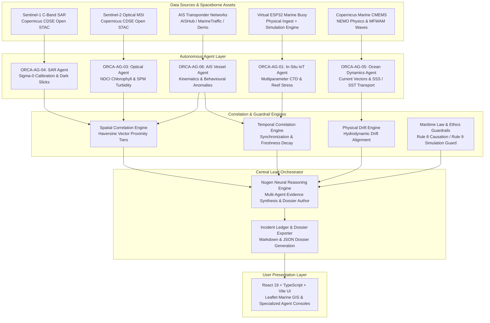

# ORCA System Architecture & Technical Specification
**Indradhanu Hackathon 2026: AI for Greener Tomorrow**  
*Marine Ecosystem Reasoning with Collaborative Autonomous Agents*

---

## 1. High-Level Architectural Design

ORCA is engineered as an **Autonomous Multi-Agent Marine Intelligence Swarm** governed by a **Central Lead Orchestrator** aligned with the Nugen neural reasoning model.

---

## 2. Specialized Autonomous Agents

### Agent 1: Sentinel-1 SAR Radar Agent (`ORCA-AG-04`)
- **Sensor**: Synthetic Aperture Radar (C-Band, 5.405 GHz).
- **Data Source**: Copernicus Data Space Ecosystem (CDSE) open STAC API (`https://stac.dataspace.copernicus.eu/v1`).
- **Processing Pipeline**:
  1. STAC product discovery and preview/quicklook asset extraction.
  2. Sigma-0 backscatter decibel ($\sigma^0 \text{ dB}$) calibration.
  3. Lee adaptive speckle filtering ($5\times 5$ kernel).
  4. Dark slick candidate extraction via adaptive backscatter thresholding (typically $-22 \text{ dB}$ to $-26 \text{ dB}$).
  5. Geometric morphology analysis: centroid coordinates, perimeter, surface area ($\text{km}^2$), and radar contrast.

### Agent 2: Sentinel-2 Multispectral Optical Agent (`ORCA-AG-03`)
- **Sensor**: Multi-Spectral Instrument (MSI) Level-2A.
- **Data Source**: CDSE open STAC metadata & public quicklooks.
- **Processing Pipeline**:
  1. Multi-channel radiometric normalization.
  2. Cloud masking thresholding (rejection of high-albedo cloud pixels).
  3. Aquatic pixel extraction via Normalized Difference Water Index (NDWI):
     $$\text{NDWI} = \frac{\text{Green} - \text{NIR}}{\text{Green} + \text{NIR}}$$
  4. Relative optical proxy calculations:
     - **NDCI (Normalized Difference Chlorophyll Index)**: proxy for surface algal concentration:
       $$\text{NDCI} = \frac{\text{RedEdge} - \text{Red}}{\text{RedEdge} + \text{Red}}$$
     - **SPM (Suspended Particulate Matter)**: proxy for coastal sediment load and turbidity.
  5. Scientific disclaimer attachment distinguishing surface proxies from certified laboratory chemical measurements.

### Agent 3: Oceanographic Dynamics Agent (`ORCA-AG-05`)
- **Models**: Copernicus Marine Service (CMEMS) numerical models (NEMO global physics, MFWAM wave models).
- **Capabilities**:
  1. Real-time extraction of Sea Surface Temperature (SST, converted to $^\circ\text{C}$), Sea Surface Salinity (SSS, in $\text{PSU}$), Significant Wave Height ($H_s$, in meters), and Sea Surface Currents ($u, v$ eastward/northward vectors).
  2. Current velocity and direction computation:
     $$\text{Speed} = \sqrt{u^2 + v^2} \times 1.94384 \quad (\text{knots})$$
     $$\text{Direction} = (\text{atan2}(u, v) \times \frac{180}{\pi} + 360) \pmod{360} \quad (^\circ)$$
  3. Contextual environmental transport modeling for oil slick drifting.

### Agent 4: AIS Vessel Intelligence Agent (`ORCA-AG-06`)
- **Capability**: VHF Marine Transponder kinematics and behavioral analytics.
- **Data Sources**: AISHub API, MarineTraffic API, and controlled Demonstration feeds.
- **Kinematic Anomaly Detectors**:
  - `UNUSUAL_LOITERING`: Speed $< 2.0 \text{ kts}$ in open water for cargo/tankers.
  - `SIGNAL_GAP_DARK_ACTIVITY`: Transponder silence exceeding ITU-R reporting schedules.
  - `REPEATED_COURSE_CHANGES`: Sharp zig-zagging maneuver detection ($> 60^\circ$ course changes).
  - `SENSITIVE_AREA_ACTIVITY`: Unauthorized entry into Marine Protected Areas (MPAs).
- **Rule 8 Maritime Law Guardrail**: Strictly enforces that spatial proximity to a marine anomaly does not constitute legal proof of discharge liability.

### Agent 5: Virtual ESP32 Marine Buoy & IoT Agent (`ORCA-AG-01`)
- **Hardware Profile**: ESP32 microcontroller with multi-parameter CTD and water quality probes.
- **Sensors**: Dissolved Oxygen ($\text{mg/L}$), pH ($0-14$), Turbidity ($\text{NTU}$), Salinity ($\text{PSU}$), Water Temperature ($^\circ\text{C}$), Acoustic Noise ($\text{dB}$), Battery ($\%$), Signal ($\text{dBm}$).
- **Modes**:
  - `SIMULATED`: In-memory realistic physics-based sensor generation with scenario switching (`normal`, `anomaly`, `offline`).
  - `LIVE`: Authenticated hardware ingestion interface (`POST /api/v1/telemetry/ingest` with `X-ORCA-DEVICE-KEY`).

---

## 3. Central Lead Orchestrator & Evidence Synthesis

The Lead Orchestrator implements a 4-stage multi-agent intelligence cycle:

1. **Multimodal Evidence Harvesting**:
   Queries all 5 agents concurrently using asynchronous non-blocking worker tasks.

2. **Spatial Correlation Engine**:
   Evaluates geographic distances using the Haversine great-circle formula:
   $$d = 2R \arcsin\left(\sqrt{\sin^2\left(\frac{\Delta\phi}{2}\right) + \cos(\phi_1)\cos(\phi_2)\sin^2\left(\frac{\Delta\lambda}{2}\right)}\right)$$
   Categorizes proximity into 5 discrete tiers:
   - `INTERSECTS` ($< 1.0\text{ km}$)
   - `WITHIN_IMMEDIATE_PROXIMITY` ($< 5.0\text{ km}$)
   - `WITHIN_LOCAL_AREA` ($< 25.0\text{ km}$)
   - `DISTANT` ($< 100.0\text{ km}$)
   - `DISJOINT` ($\ge 100.0\text{ km}$)

3. **Temporal Correlation Engine**:
   Evaluates time difference $\Delta t$ between observations and applies exponential freshness decay:
   $$w(t) = e^{-\lambda \Delta t}$$

4. **Physical Drift Alignment**:
   Tests whether a detected surface slick could have originated from a vessel's prior track given Copernicus Marine current velocities and wind vectors.

5. **Nugen Neural Deliberation**:
   Synthesizes findings into hypothesis rankings, evidence corroboration scores, isolated conflicting reports, and prioritized response actions.

---

## 4. Frontend Architecture

- **React 19 + TypeScript**: Modular, type-safe single-page application.
- **Vite 8+**: Lightning-fast Hot Module Replacement (HMR) and optimized Rollup client build.
- **Tailwind CSS**: Sleek dark-mode aesthetic designed for 24/7 maritime operation centers.
- **Leaflet + React-Leaflet**: GPU-accelerated GIS mapping with custom SVG vessel heading indicators, satellite footprint overlays, and live pulse animations.
